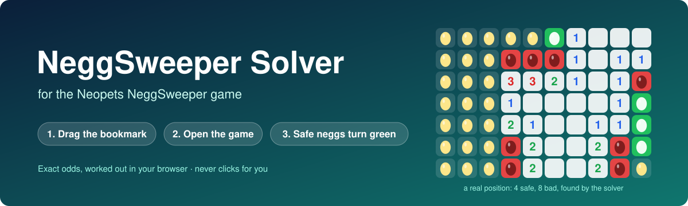
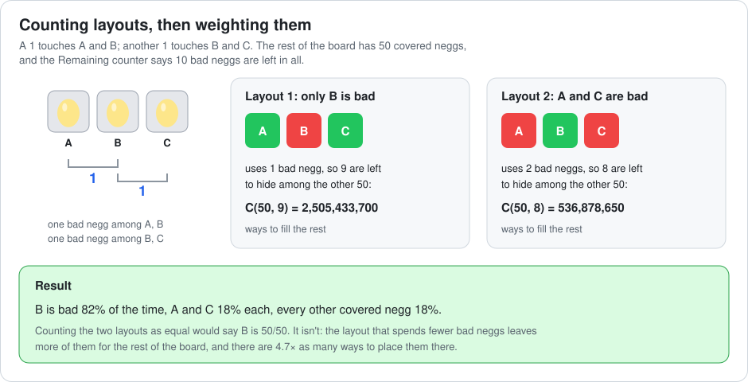
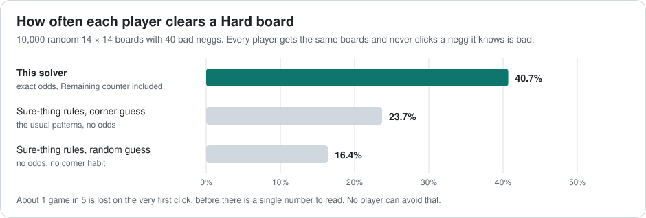
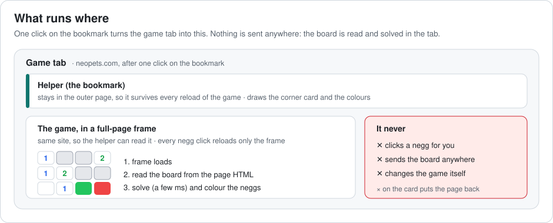

  

  

  <a href="#how-to-use">How to use</a>
  &nbsp;·&nbsp; <a href="#how-it-solves-a-board">How it works</a>
  &nbsp;·&nbsp; <a href="#how-well-it-plays">How well it plays</a>
  &nbsp;·&nbsp; <a href="#how-its-built">How it's built</a>
  &nbsp;·&nbsp; <a href="#more-neopets-solvers">More solvers</a>

---

**NeggSweeper Solver** marks every negg on a Neopets NeggSweeper board as safe, bad, or
"best bet", right on the game page. It's one bookmark. The odds are worked out exactly in your
own browser, nothing is sent anywhere, and it never clicks for you.

<picture><source media="(prefers-color-scheme: dark)" srcset="docs/divider-dark.svg"></picture>

<h1 align="center">⚙️ Under the hood</h1>

<i>How to use it · how it solves a board · how well it plays · how it's built</i>

---

## How to use

| | Step | What you do |
|:-:|---|---|
| **1** | **Add the bookmark** | Open the [solver page](https://fang89.github.io/Neopets-neggsweeper-solver/) and drag the orange **NeggSweeper Helper** button to your bookmarks bar (favorites bar in Edge). No bar? <kbd>Ctrl</kbd>+<kbd>Shift</kbd>+<kbd>B</kbd>, or <kbd>⌘</kbd>+<kbd>Shift</kbd>+<kbd>B</kbd> on a Mac. |
| **2** | **Open the game** | Go to NeggSweeper on neopets.com and start a board. |
| **3** | **Click the bookmark once** | The neggs light up, and the one to click next glows with a label pointing at it. It keeps working after every click, every win and every new game until you close the tab. |

| Colour | Meaning |
|:-:|---|
| 🟩 | **Safe.** Bad in no possible layout. Click any of them. |
| 🟥 | **Bad.** Bad in every possible layout. Leave it. |
| 🟧 *pulsing* | **Best bet.** Nothing is certain, so this is the negg least likely to be bad. |

The card in the corner counts the safe neggs and can print the odds on every covered negg.
Its **×** puts the page back to normal. Flagging a negg (<kbd>Ctrl</kbd>-click, or
<kbd>Shift</kbd>-click on a Mac) doesn't confuse it.

Works in Chrome, Edge and Firefox, on Windows and Mac.

> The helper only colours neggs. It never clicks for you and never sends anything.

<picture><source media="(prefers-color-scheme: dark)" srcset="docs/divider-dark.svg"></picture>

## How it solves a board

Most NeggSweeper help stops at the sure-thing patterns: a 1 with one covered negg next to it,
and so on. Those find the green and red neggs, but when nothing is certain they leave you
guessing blind. This solver counts instead.

### 1 · Split the board into groups

Only covered neggs next to a number are constrained. They're split into groups that share no
number, because what happens in one group can't affect another. Each group is walked
neighbour by neighbour, so a wrong branch hits a broken number early and is dropped.

### 2 · List every layout that fits

For each group the solver lists every way of hiding bad neggs that matches all its numbers,
and tallies them by how many bad neggs each layout uses.

### 3 · Weight the layouts with the Remaining counter

This is the step the sure-thing rules skip. The game tells you how many bad neggs are left in
total. A layout that uses fewer of them near the numbers leaves more for the untouched part of
the board, and there are usually far more ways to scatter them there (the example above). Each
layout is weighted by that count, and the groups are combined, so every covered negg gets its
exact chance of being bad.

### 4 · Call only what is certain

A negg is green only if it is safe in **every** layout, and red only if it is bad in every
layout. Those calls come from the layouts themselves, never from rounded odds, so a green negg
is never a guess. When nothing is green, the orange negg has the lowest chance. Ties go to
the negg with the fewest covered neighbours, since a corner opens up the most board when it
turns out safe.

<picture><source media="(prefers-color-scheme: dark)" srcset="docs/divider-dark.svg"></picture>

## How well it plays

All three players clear the same 10,000 random Hard boards (14 × 14, 40 bad neggs) and all of
them find every sure thing. The difference is entirely in how they guess when they have to,
and Hard makes you guess about three times a game. Using the exact odds wins **40.7%** of
games against 23.7% for the usual patterns.

In the tests (1,000 more simulated games and 53 real saved boards) it never called a bad negg
safe or a safe negg bad, and the slowest board took 2 ms to solve.

<picture><source media="(prefers-color-scheme: dark)" srcset="docs/divider-dark.svg"></picture>

## How it's built

| Part | Language | Size |
|---|---|---|
| **Solver**: board reader, groups, layout counting, odds | **JavaScript**, no libraries | ~280 lines |
| **Bookmark**: frame, corner card, colours | JavaScript bookmarklet | ~140 lines |
| **Solver page**: set-up steps, live demo board | HTML + CSS + JavaScript | ~210 lines |
| **Build**: inlines everything into one page | Bash + Python | |
| **Tests**: real saved boards, 1,000 simulated games, the bookmark on a stand-in game page (never the real site) | Node + Python + Playwright | ~340 lines |

**Why a frame.** Every negg click reloads the game page, which would wipe out an ordinary
bookmark after one move. So one click wraps the game in a full-page frame from the same
site, and the helper lives in the page around it. Each time the frame loads, the helper reads
the board again, solves it and repaints. Because the frame is the same site, the helper
can read it directly: no extension, no permissions.

**Reading the board.** Everything comes from the game page's own HTML: covered neggs, numbers,
flags and the Remaining counter. Nothing is read off a screenshot.

**Exact without overflowing.** Layout counts on a big board run into the billions and beyond,
so the weights are added up as logarithms. If a board is ever too big to list in full (it
hasn't happened in testing), the solver falls back to the sure-thing rules and says so on the
card instead of guessing.

**One file.** The whole solver is inside the bookmark itself, so it runs on the game page with
nothing to load. The solver page is a single ~45 KB HTML file.

<picture><source media="(prefers-color-scheme: dark)" srcset="docs/divider-dark.svg"></picture>

## More Neopets solvers

| Tool | What it does | Links |
|---|---|:-:|
| **Sewage Surfer Solver** | Shows where each pipe goes, one move at a time, and when to discard, press Start Flow or restart. | <a href="https://fang89.github.io/Neopets-sewagesurfer-solver/">Link&nbsp;to&nbsp;solver</a> <a href="https://github.com/fang89/Neopets-sewagesurfer-solver">Github&nbsp;link</a> |
| **ShapeShifter Solver** | Paste the board, get the answer, see where each piece goes. | <a href="https://fang89.github.io/Neopets-shapeshifter-solver/">Link&nbsp;to&nbsp;solver</a> <a href="https://github.com/fang89/Neopets-shapeshifter-solver">Github&nbsp;link</a> |
| **Grand Theft Ummagine Guide** | A drawn map and key-tap route for every level. | <a href="https://github.com/fang89/grand-theft-ummagine-guide">Github&nbsp;link</a> |
